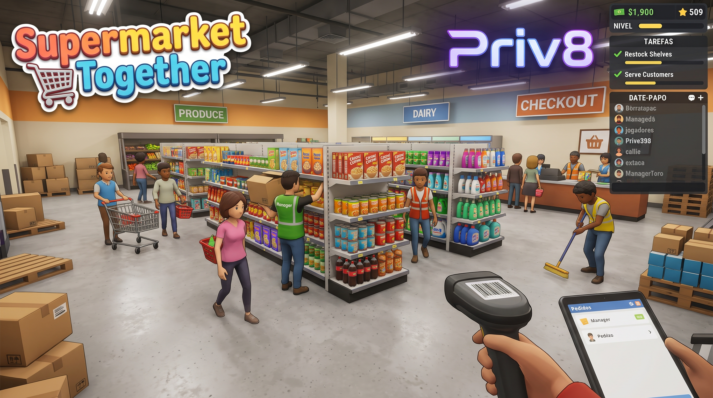
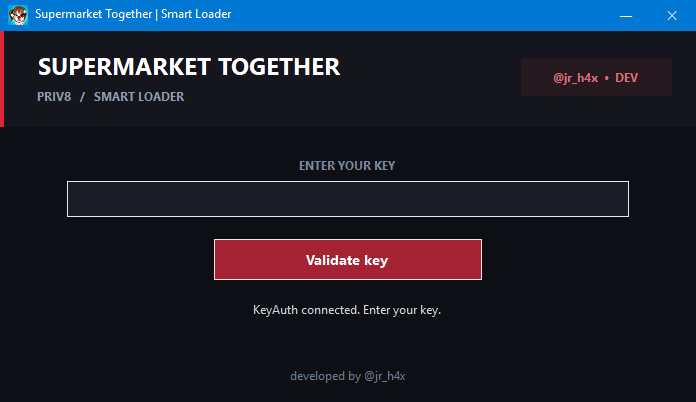
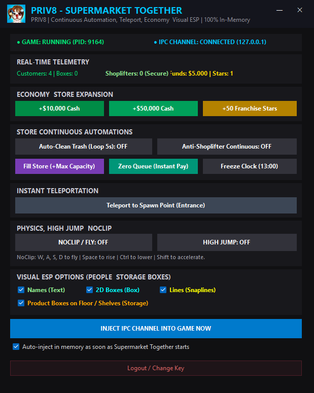
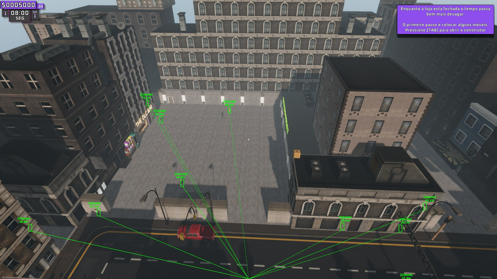

  

<h1 align="center">PRIV8 — Supermarket Together</h1>

  <strong>Continuous Automation, Teleport, Economy & Visual ESP</strong>

PRIV8 is a dedicated tool for *Supermarket Together*, providing a standalone loader with seamless in-memory injection and a comprehensive control panel for store automation, economy expansion, player physics, instant teleportation, and visual ESP.

## Features

### Economy & Store Expansion
- **Instant Cash Injection (+10,000 / +50,000)** — Instantly deposit funds into your supermarket balance to purchase products, licenses, and store expansions.
- **+50 Franchise Stars** — Add franchise points on demand to unlock upgrades, perks, and expanded facilities.
- **Live Financial Telemetry** — Real-time monitor tracking current balance and total franchise stars.

### Store Automation & Efficiency
- **Auto Clean Trash & Dirt** — Automatically removes litter, garbage, and dirty spots from the store floor without manual sweeping.
- **Auto Stop Shoplifters** — Instantly neutralizes thieves upon theft attempts, preventing product shrinkage.
- **Boost Customer Capacity** — Expands maximum customer traffic capacity up to 70 shoppers simultaneously.
- **Instant Checkout Queue** — Cashes out and processes all customers currently queuing at cash registers in one click.
- **Freeze / Pause Store Time** — Freeze operational store hours to restock shelves, reorganize merchandise, and prepare freely.

### Instant Teleportation & Player Physics
- **Teleport to Entrance / Spawn** — Instant one-click teleportation to the main supermarket entrance and delivery spawn zone.
- **Ghost NoClip** — Walk freely through walls, display shelves, storage doors, and map collision boundaries.
- **Super Jump Boost** — Enhances vertical jump height for rapid navigation across the supermarket.

### Visual ESP (People & Storage)
- **Customer & Staff Name ESP** — Displays live name tags above shoppers, employees, and thieves.
- **2D Bounding Boxes** — Visual 2D bounding boxes framing human entities.
- **Directional Snaplines** — Direct line tracers pointing toward active entities in your field of view.
- **Storage & Product Box ESP** — Highlights restock cardboard boxes on the floor, in back storage, or on shelves.

### System & Engine Integration
- **100% In-Memory Injection** — Native DLL injection via high-speed IPC channel directly into the game's Mono runtime.
- **Auto-Injection** — Automatically detects and hooks into the game process as soon as *Supermarket Together* launches.
- **Insert Key Hotkey** — Seamlessly toggle control dashboard visibility on and off at any time.
- **Live NPC & Box Counters** — Live telemetry displaying active customer count and detected storage boxes.

## Screenshots

### Loader

### In-Game Control Panel

### Gameplay

## Access & Authentication

A valid authentication key is required to access PRIV8.

Free access keys are available at:

**https://phsldev.eu.org/**

## Compatibility

Designed for **Supermarket Together** on Steam (64-bit Windows / Unity Mono).

## Developer

**jrh4x** &nbsp;

## Download

  <a href="https://github.com/jrh4x/priv8-supermarket-together-loader/raw/refs/heads/main/Priv8%20-%20Supermarket%20Together.exe">
    <strong>DOWNLOAD PRIV8</strong>
  </a>

---

*PRIV8 is an independent community project. It is not affiliated with, endorsed by, or sponsored by DeadCode or Valve Corporation.*
